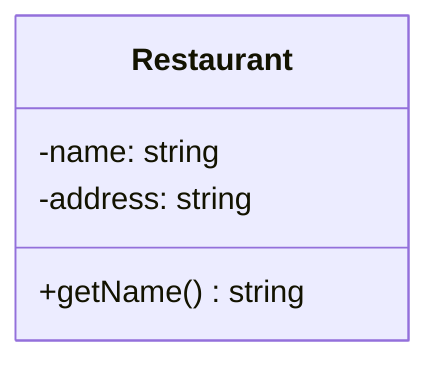
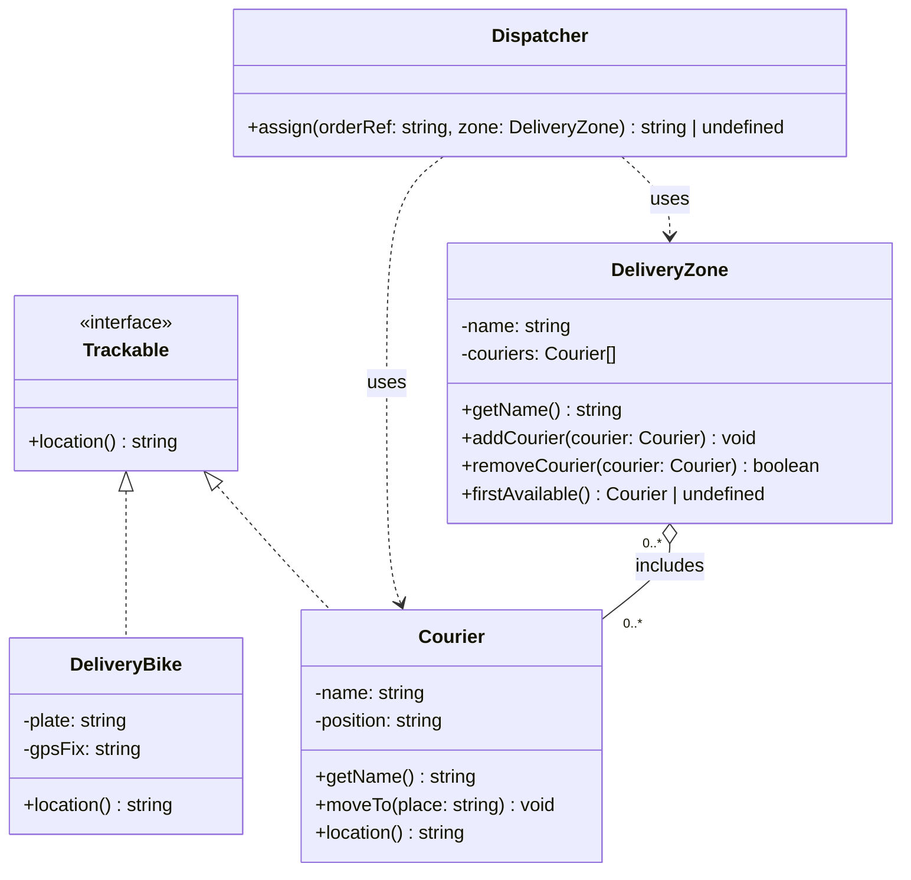
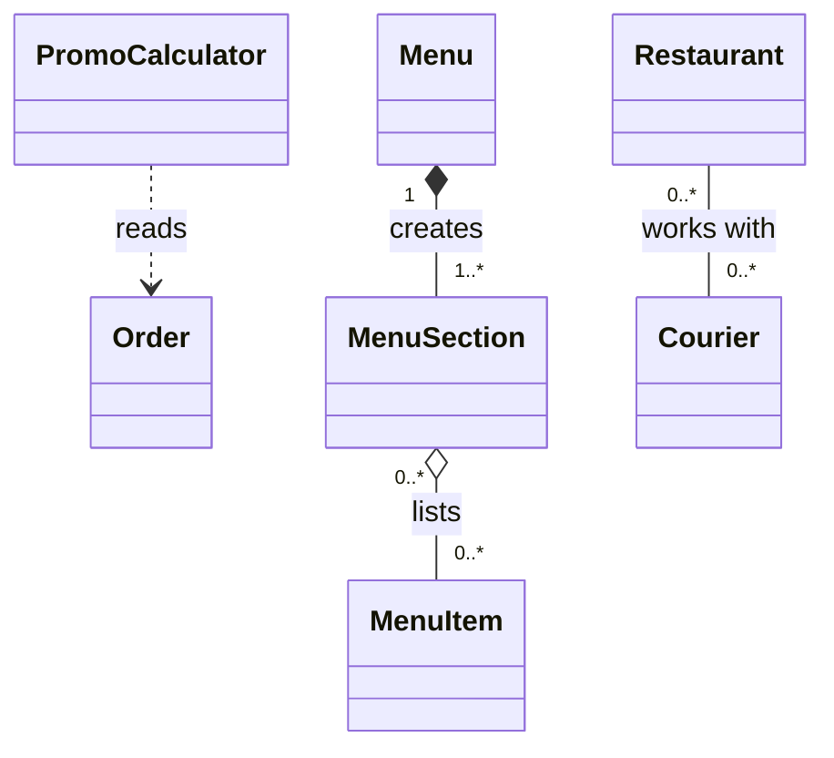
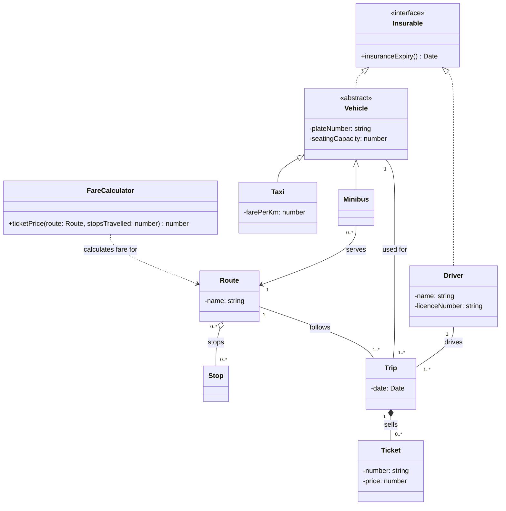
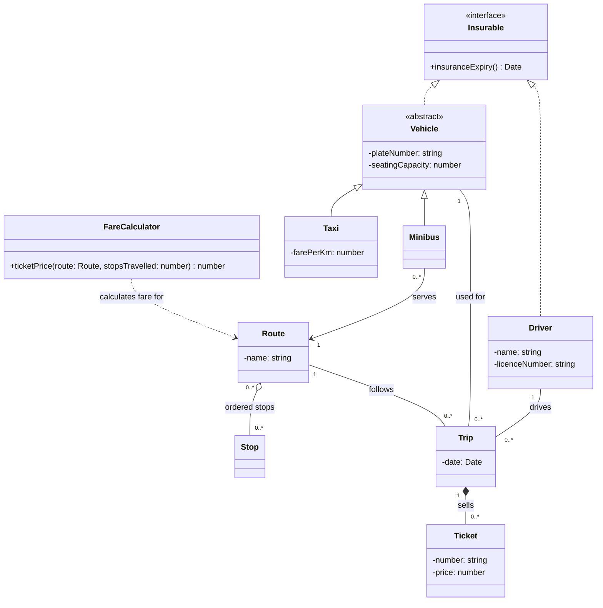

# Lab 5 — Answers

## Step 1



## Step 4

| Line | Will it be underlined in red? Which symbol in the diagrams of Steps 1 and 3 tells you? | The error message |
|---|---|---|
| (a) | Yes; `<<abstract>>` on `MenuItem` | Cannot create an instance of an abstract class. |
| (b) | Yes; `#category()` is protected | Property `category` is protected and only accessible within class `MenuItem` and its subclasses. |
| (c) | Yes; `-name` is private | Property `name` is private and only accessible within class `Customer`. |

## Question 1

- (a) **Yes** — `0..*`, at the `Order` end.
- (b) **No** — `1`, at the `Customer` end.
- (c) **Yes** — `0..*`, at the `OrderLine` end.
- (d) **No** — `1`, at the `MenuItem` end.

## Question 2

Without `OrderLine`, the order has nowhere to store the quantity for each item (and therefore cannot calculate each item's subtotal).

## Question 3

An `Order` creates and owns its `OrderLine`s, while a `MenuItem` exists independently and can be referred to by many lines.

## Question 4

- (a) No. An association describes a relationship between objects; the code need not store a field or provide navigation in both directions.
- (b) Neither is inherently wrong: an order may be empty while it is being built, even if a completed order should have at least one line. The diagram could use `0..*` at the `OrderLine` end to include that construction state.

## Part B diagram



### Prediction 2

```text
Moussa
undefined Moussa Médina
```

### Question 5

The test removes Moussa from `plateau`, adds the same courier to `medina`, and then moves him; the courier remains an independent object rather than being destroyed with either zone.

### Question 6

`Dispatcher` would need to retain a `DeliveryZone` reference as one of its fields; `assign()` only uses the zone temporarily, so the relationship is a dependency.

### Question 7

| Relationship | Line number in `dispatch.ts` | That line of code |
|---|---:|---|
| `Courier` realizes `Trackable` | 5 | `class Courier implements Trackable {` |
| `DeliveryBike` realizes `Trackable` | 27 | `class DeliveryBike implements Trackable {` |
| `DeliveryZone` aggregates `Courier` | 43, 53–54 | `couriers: Courier[]` and `addCourier` stores the passed courier |
| `Dispatcher` depends on `DeliveryZone` | 70–71 | `assign` accepts a zone and calls `zone.firstAvailable()` |
| `Dispatcher` depends on `Courier` | 71–73 | The returned courier is used to call `getName()` |

## Prediction 3

With the Step 13 implementation that shares the first order line:

```text
6500 5000
26500 25000
```

## Question 8

The claim that each line belongs to exactly one order is false. `getLines()` hands the order's parts out, and `addExistingLine()` lets another order take the same part in.

## Question 9

The **is-a** test fails first: being a courier role does not make someone a restaurant customer. A courier also cannot substitute for a customer that has a phone number, and the two roles may change independently. Model `Courier` and `Customer` as separate classes; if they share person details, put those details in a separate `Person` object or base type only when the domain needs it.

## Question 10



| # | Relationship | Reason, in one sentence |
|---|---|---|
| 1 | Dependency | `PromoCalculator` uses an `Order` temporarily and keeps no reference to it. |
| 2 | Composition | `Menu` creates its sections, and a `MenuSection` has no independent meaning outside its menu. |
| 3 | Aggregation | `MenuItem`s exist independently and can be listed by multiple sections. |
| 4 | Association | A restaurant and a courier can each work with several instances of the other. |

## Part E — working diagram


## Part E — first draft



## Question 11

| Classes | Relationship | Requirement sentence that justifies it |
|---|---|---|
| `Vehicle`, `Minibus` | Generalization | "Each vehicle is either a **minibus** (which serves one fixed route) or a **taxi** (which has a fare per kilometre)." |
| `Vehicle`, `Taxi` | Generalization | "Each vehicle is either a **minibus** (which serves one fixed route) or a **taxi** (which has a fare per kilometre)." |
| `Vehicle`, `Insurable` | Realization | "Vehicles and drivers must both be able to report `insuranceExpiry(): Date`." |
| `Driver`, `Insurable` | Realization | "Vehicles and drivers must both be able to report `insuranceExpiry(): Date`." |
| `Minibus`, `Route` | Association | "Each vehicle is either a minibus (which serves one fixed route) or a taxi (which has a fare per kilometre)." |
| `Driver`, `Trip` | Association | "A trip records a date, the driver, the vehicle and the route. A driver makes many trips, and so does a vehicle." |
| `Vehicle`, `Trip` | Association | "A trip records a date, the driver, the vehicle and the route. A driver makes many trips, and so does a vehicle." |
| `Route`, `Trip` | Association | "A trip records a date, the driver, the vehicle and the route." |
| `Trip`, `Ticket` | Composition | "A ticket has a number and a price, belongs to exactly one trip, and means nothing without it." |
| `Route`, `Stop` | Aggregation | "A route has a name and an ordered list of stops. The same stop, for example Colobane, is used by several routes." |
| `FareCalculator`, `Route` | Dependency | "A fare calculator computes a ticket price from a route and a number of stops travelled. It keeps nothing." |

- (a) Choosing between composition and aggregation for the route's stops was hardest. The stops are parts of a route's ordered list, but the same stop is reused by several routes, so the route must not own or destroy it.
- (b) In the first draft I required every driver, vehicle, and route to have at least one trip; rereading the requirements showed those objects can exist before any trip, so I changed those multiplicities to `0..*`. I also changed the stop-link label to `ordered stops` to preserve the requirement that a route's stops have an order.

## Part E — final


